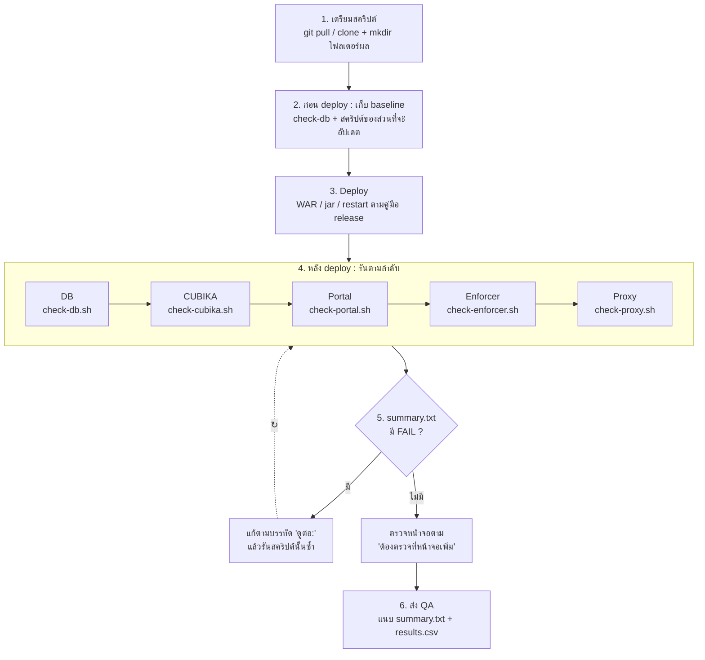

# Workflow การตรวจความพร้อม



## ทำไมเรียงลำดับนี้

แต่ละชั้นพึ่งชั้นก่อนหน้า — ถ้าชั้นแรก FAIL ชั้นหลังจะ FAIL ตามเป็นทอด ๆ

| ลำดับ | สคริปต์ | พึ่ง |
|---|---|---|
| 1 | check-db | — |
| 2 | check-cubika | DB (hibernate ต่อ DB, schema check) |
| 3 | check-portal | CUBIKA (`app.datamarket.context`), proxy client id |
| 4 | check-enforcer | catalog ของ CUBIKA (`app.properties`) |
| 5 | check-proxy | portal (`aad.proxy.scope`), usermapping API ของ CUBIKA |

## ขั้นตอน

### 1. เตรียม (ครั้งแรก / ทุกครั้งที่มีเวอร์ชันใหม่)

```bash
git clone https://github.com/Pack-22/cbi-check.git /home/cbiaccess/cbi-check   # ครั้งแรก
git -C /home/cbiaccess/cbi-check pull                                          # ครั้งต่อไป
mkdir -p /home/cbiaccess/check && cd /home/cbiaccess/check
```

ตรวจว่าค่าคาดหวัง (`EXPECT_*`) ตรงกับ release ที่จะ deploy — ถ้าไม่ตรง แก้แล้ว commit ก่อน (ดู README)

### 2. ก่อน deploy — เก็บ baseline

```bash
cd /home/cbiaccess/check
/home/cbiaccess/cbi-check/check-db.sh            # ตาราง / ขนาด / SYS_CONFIG ก่อนอัปเดต
/home/cbiaccess/cbi-check/check-cubika.sh        # รันเฉพาะส่วนที่จะอัปเดตรอบนี้
```

ผลที่ได้ใช้เทียบหลัง deploy — config / log / process ก่อนเปลี่ยนจะอยู่ใน `evidence/`

### 3. Deploy

ทำตามคู่มือของ release (WAR, jar ของ agent, config, restart)

### 4. หลัง deploy — รันตามลำดับ

```bash
cd /home/cbiaccess/check
/home/cbiaccess/cbi-check/check-db.sh            # เลือก baseline = รอบที่ทำในข้อ 2 (สคริปต์เสนอให้เอง)
/home/cbiaccess/cbi-check/check-cubika.sh
/home/cbiaccess/cbi-check/check-portal.sh
/home/cbiaccess/cbi-check/check-enforcer.sh
/home/cbiaccess/cbi-check/check-proxy.sh
```

ไม่ต้องรันครบทุกครั้ง

| อัปเดตอะไร | รัน |
|---|---|
| WAR ของ CUBIKA | db → cubika → enforcer |
| WAR ของ portal | portal → proxy |
| jar ของ enforcer | enforcer |
| proxy / config ของ proxy | proxy → portal |
| ทั้งหมด | ครบ 5 ตัว |

### 5. อ่านผล

```bash
cat cbi-check-history.csv                         # ภาพรวมทุกรอบ
cat cubika_<host>_<เวลา>/summary.txt              # รายละเอียดรอบนั้น
```

- **FAIL** → ทำตาม `ดูต่อ:` แก้แล้วรันสคริปต์นั้นซ้ำ (ได้โฟลเดอร์ใหม่ ; ของเดิมยังอยู่ไว้เทียบ)
- **WARN** → ใช้งานได้ บันทึก / แจ้งทีมตามที่เขียนไว้
- ดูหลักฐานเพิ่มใน `evidence/` (config ที่ใช้จริง, log ตั้งแต่ start ล่าสุด)

### 6. ตรวจหน้าจอ แล้วส่ง QA

ทำรายการ "ต้องตรวจที่หน้าจอเพิ่ม" ท้าย `summary.txt` (หน้าเวอร์ชัน, Deploy Queue, login SSO, ดาวน์โหลด)

> Passthrough : proxy จะมี `[entra-jwt] Accepted` หลังมีคนดาวน์โหลดแบบ Passthrough เท่านั้น —
> ทดสอบดาวน์โหลดที่ portal ก่อน แล้วรัน `check-proxy.sh` ซ้ำ

### Passthrough ยังใช้ไม่ได้ — ไล่ทั้ง flow

รัน `check-passthrough.sh` บนทุกเครื่องในเส้นทาง (เครื่อง proxy, เครื่อง CUBIKA, เครื่อง portal) ;
ไม่แน่ใจเรื่องเครือข่ายขาออกให้รัน `-n` ก่อน (ไม่เปิด connection ใด ๆ) แล้วค่อยรันแบบปกติ
แก้ข้อ FAIL แรกของชั้นล่างก่อน (proxy → CUBIKA → portal) แล้วรันซ้ำ

แนบให้ QA : `summary.txt` + `results.csv` ของแต่ละสคริปต์

เก็บผลทั้งรอบ :
```bash
tar czf check_$(date +%F).tgz *_$(hostname)_* cbi-check-history.csv
```
