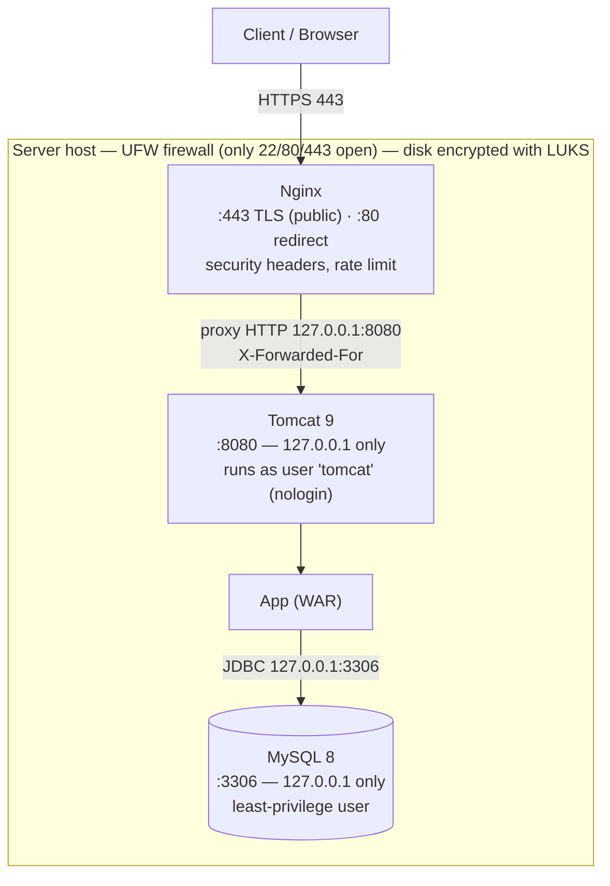
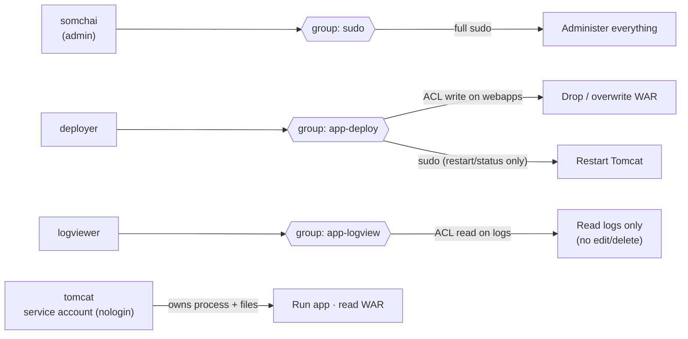
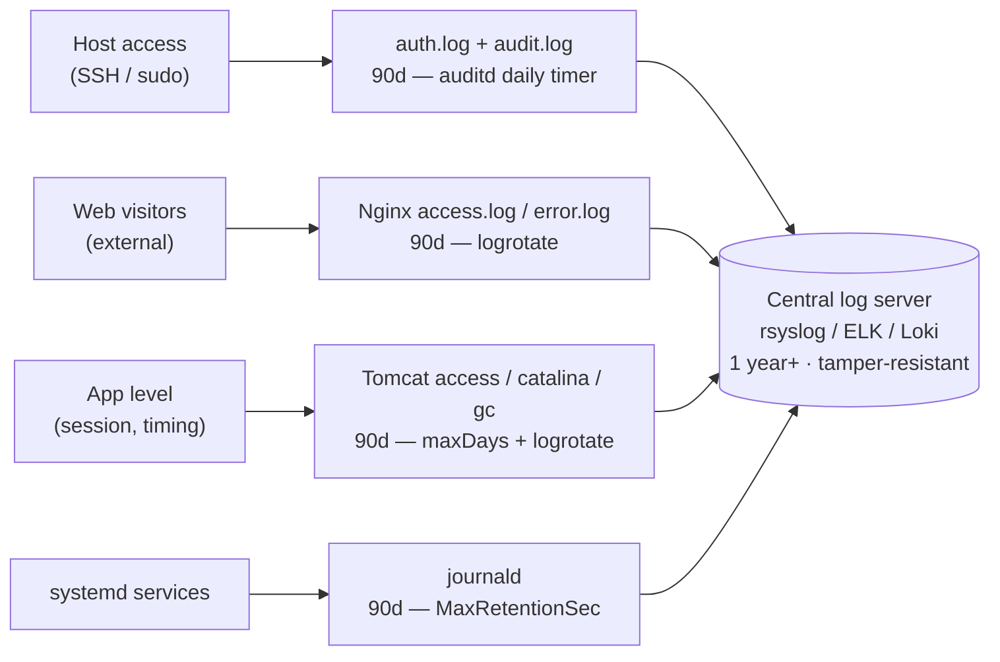
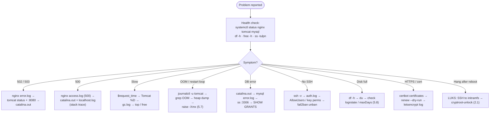

# Secure Stack — Diagrams

Visual overview of the Secure Stack guide. GitHub renders these Mermaid blocks as diagrams automatically.

---

## 1. Architecture / request flow

How a request travels, and where each component is exposed. Only ports **22 / 80 / 443** are open at the firewall; MySQL and Tomcat listen on localhost only; the whole disk is encrypted with LUKS.

---

## 2. RBAC / user permissions

Permissions are defined on **groups**, not people. Add/remove a person by changing their group membership — never per-person permissions. `tomcat` is a nologin service account that owns the running app.

---

## 3. Logging & retention

Who/what is recorded, which file it lands in, and the on-machine retention (default **90 days, daily**). For long retention (e.g. 1 year for PCI-DSS) logs are forwarded to a central server.

---

## 4. Troubleshooting runbook (decision tree)

A request travels Client → Nginx → Tomcat → app → MySQL. Check overall health first, then follow the branch for your symptom (trace the logs layer by layer).

