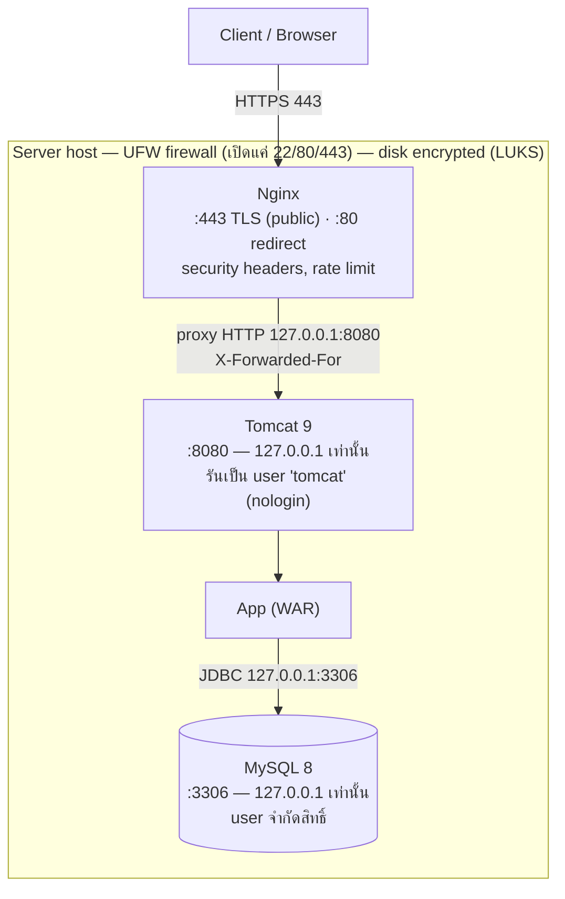
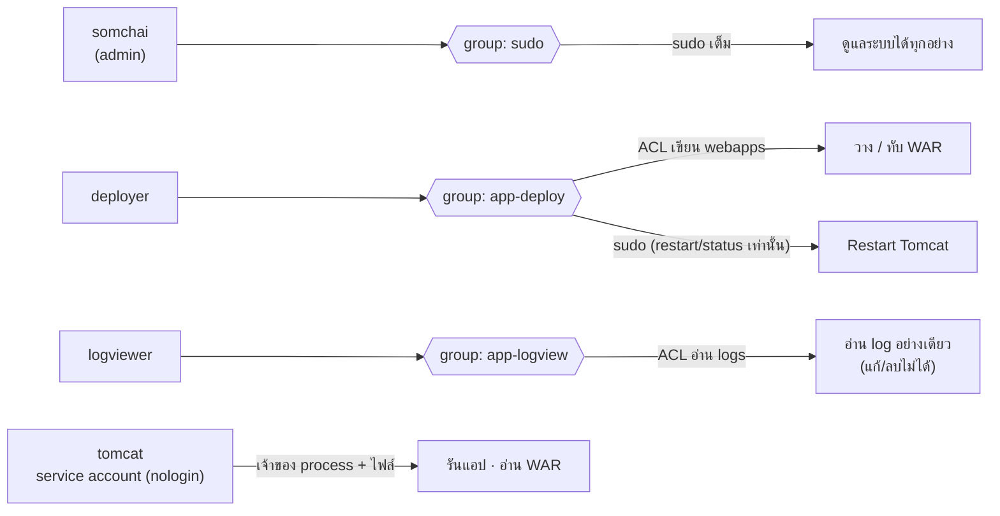
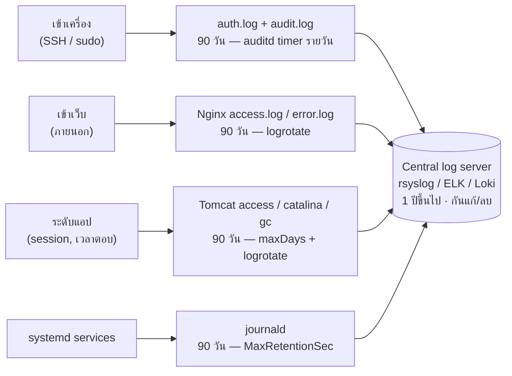
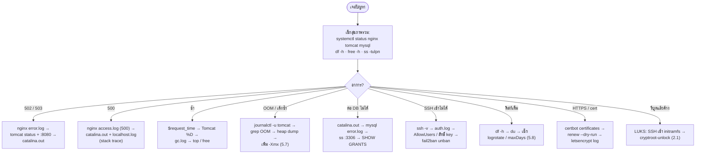

# Secure Stack — แผนภาพ (Diagrams)

ภาพรวมของคู่มือ Secure Stack · GitHub เรนเดอร์บล็อก Mermaid ด้านล่างเป็นรูปให้อัตโนมัติ

---

## 1. สถาปัตยกรรม / request flow

เส้นทางของ request และจุดที่แต่ละ component เปิดรับ · firewall เปิดแค่พอร์ต **22 / 80 / 443** · MySQL กับ Tomcat listen เฉพาะ localhost · ทั้งดิสก์เข้ารหัสด้วย LUKS

---

## 2. RBAC / สิทธิ์ผู้ใช้

นิยามสิทธิ์ไว้ที่ **group** ไม่ใช่ที่ตัวคน · เพิ่ม/ถอดคน = เปลี่ยน group ไม่ต้องแก้สิทธิ์รายคน · `tomcat` เป็น service account (nologin) ที่เป็นเจ้าของแอปที่รันอยู่

---

## 3. Logging & retention

ใคร/อะไรถูกบันทึก ลงไฟล์ไหน และ retention ในเครื่อง (default **90 วัน รายวัน**) · ถ้าต้องเก็บยาว (เช่น 1 ปีตาม PCI-DSS) ให้ ship ออก central server

---

## 4. Runbook แก้ปัญหา (decision tree)

request เดินทาง Client → Nginx → Tomcat → app → MySQL · เช็กสุขภาพรวมก่อน แล้วไล่ตามอาการ (ดู log ทีละชั้น)

